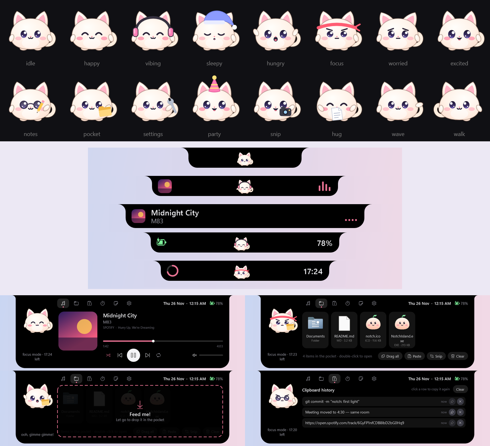
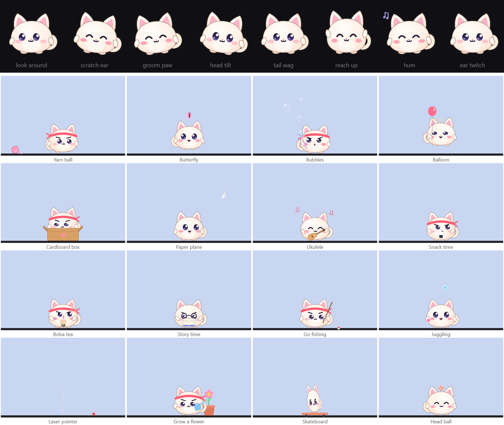

# Notch Island

A Mac-style dynamic notch for Windows, with a little mascot named Mochi living in it.

Build it once (see Building below), then run `bin\NotchIsland.exe`. It sits at the top-centre of your main screen and in the system tray.

## What it does

**Music (Spotify, YouTube in a browser, Media Player, anything in the Windows media flyout)**
- Collapsed: album art, Mochi bobbing to the beat, and a live visualizer driven by your real audio output.
- Expanded: title, artist, album, a seek bar you can click or drag, play/pause, previous/next, shuffle, repeat, volume and mute.
- A "now playing" pop-up when the song changes. The notch glow takes its colour from the album art.
- Click the album art to jump to the player. Middle-click the notch to play/pause.

**File pocket (shelf)**
- Drag files or folders onto the notch. It opens, Mochi opens wide and chomps them.
- Switch apps, open the notch again, and drag them back out, one at a time or all at once with "Drag all".
- Dropped text becomes a `.txt` file, links become `.url` shortcuts, and images become `.png` files.
- **Paste** adds whatever is on your clipboard. **Snip** opens the Windows screenshot tool and drops the result straight into the pocket.
- The pocket only holds references to your files. It never moves or copies them, and it remembers them after a restart.

**iPhone drop (iPhone ↔ laptop over Wi-Fi)**
- Open the notch, go to the pocket tab and tap **iPhone**. Scan the QR code with your iPhone camera.
- Safari opens a little "Notch Drop" page. Tap **Send to laptop** and pick photos, videos or files. They land in the notch pocket (Mochi catches them) and are saved in `Downloads\From iPhone`.
- **Laptop → iPhone, delivered by Mochi:** hover a pocket file or clipboard item and tap the phone button, drop something on the notch's **Send to iPhone** zone, or use **Send clipboard** in the iPhone panel. Mochi carries it over: the phone page drops a "Mochi brought you…" banner with a preview and **Save** / **Copy** / **Open**. The notch shows "Delivered to your iPhone ✓", then "Saved on your iPhone ✓" once you tap Save.
- **Links and text, both ways:** type or paste on the phone page and tap **Send**. It lands on the laptop's clipboard, with a card in the notch (click it to open a link). Text sent from the laptop shows up on the phone with Copy and Open buttons.
- **You don't have to check:** every transfer plays as a little delivery in the notch (progress, unpacking, a green ✓), a "new" badge stays until you look, and you get a Windows notification if the notch is hidden.
- Everything in your pocket is also listed on the phone page with a **Save** button.
- Tip: in Safari, tap Share › **Add to Home Screen** for a one-tap Mochi icon.

**Ask Mochi (type or talk)**
- Press **Ctrl+Alt+Space** anywhere to open the Ask bar. Press it again, or tap the mic, to **talk** instead: Mochi shows your words as you speak and goes when you pause. Win+Alt+Space starts listening straight away (if Windows lets the app use it).
- Instant, no AI needed:
  - **Music:** "play lofi beats", "pause", "next song", "volume 40", "mute".
  - **Notes:** "note: buy milk", or "new note grocery list…" (saved to Documents › Mochi Notes and put in your pocket).
  - **Files and apps:** "find my resume" (uses Windows Search), "open calculator", "open youtube.com".
  - **Timers:** "timer 10 min", "remind me in 20 minutes to stretch".
  - **Quick helpers:** "what's 18% of 240" (the answer is copied), "google …", "send … to my phone", "copy …", "lock my laptop".
- **Claude in the background:** anything else goes to Claude Code (`claude -p`). Mochi shows "on it…" in the notch and tells you when it's done.
  - "play <song>" asks Claude to find the exact Spotify track.
  - Claude can read, search and look things up on its own. Anything that would *change* your computer, like running a command or writing a file, shows an **Allow / Don't** prompt first.
- **"terminal: …"** opens Claude in Windows Terminal so you can watch it work.
- Needs the Claude Code CLI (signed in) for the Claude parts. Each Claude request uses your Claude plan like any other.

**More**
- **Clipboard history:** the last 25 things you copied. Click one to copy it again, or pin the ones you want to keep. It stays in memory only and skips anything password managers mark as private.
- **Focus timer:** presets from 1 to 45 minutes. A countdown ring shows in the collapsed notch, and Mochi celebrates when time's up.
- **Quick notes:** a scratchpad that saves itself.
- **Pop-ups:** volume (scroll on the notch to change it), charging and low battery.
- **Hides in fullscreen:** games, fullscreen video and presentations hide the notch.
- **Hotkey:** `Ctrl+Alt+Space` opens or closes the notch. `Esc` closes it.

**Mochi (the little cat living in the notch)**
- Mochi reacts to everything you do. It wears headphones and dances to the beats of your music with a smooth bounce and sway (no jitter), twirls when you skip, covers its ears when the volume is maxed and shushes when you mute.
- It throws its arms up when you drag a file over, hugs and eats files you drop, and hands them back when you drag them out.
- It dresses for each tab: a folder in the pocket, glasses for the clipboard, glasses and a pencil for notes (and scribbles while you type), a headband during focus, a wrench in settings.
- It wears a party hat when the timer ends, grabs a camera for snips, gets zapped happy when you plug in the charger, sweats when the battery is low and puts on a nightcap when you leave it alone.
- Click to pet it.

**Taskbar buddy**

- Drag Mochi out of the open notch and it follows your cursor. Let go and it drops onto your taskbar. Fling it and it flies, bounces and lands.
- On the taskbar it plays with toys on its own: a yarn ball it chases, a butterfly that lands on its ear, bubbles, a balloon that lifts it up, a cardboard box it hides in, a paper plane, a ukulele, onigiri and boba snacks, story time with a book, fishing (sometimes it catches a boot), juggling, a laser dot, a flower it waters and a skateboard.
- Right-click Mochi to pick a toy yourself. Click the yarn ball to kick it, pop bubbles, or shoo the butterfly.
- In between, it wanders, waves at and chases your cursor, swings its legs and naps.
- When idle it breathes and fidgets: it looks around, scratches an ear, licks a paw, tilts its head, wags its tail, taps a foot, stretches and hums.
- It dances when music plays and focuses when the timer is running. It still reacts to everything you do in the notch.
- Send it home by dragging or throwing it at the notch, double-clicking it, using "Call home" in the notch, or the tray menu ("Let Mochi out / Call Mochi home").
- It remembers whether it was out and where after a restart. It hides with the notch in fullscreen apps.

## iPhone drop: setup notes
- **First time:** Windows Firewall asks whether Notch Island may use the network. Click **Allow**. If your Wi-Fi is set to *Public*, either tick *Public networks* in that prompt or switch the network to *Private* (Settings › Network & internet › Wi-Fi › your network › Network profile type).
- **Privacy:** it only works on your own Wi-Fi, and nothing goes through the internet or any cloud. Every link has a secret key, and anything without it gets "not found". **New key** makes old QR codes and home-screen icons stop working. The connection is plain HTTP on your local network, so use it on Wi-Fi you trust. Turn it off with **Turn off** or in settings ("iPhone drop").
- **Send from any app (optional):** in the Shortcuts app, make a shortcut that shows in the Share Sheet and accepts files. Add **Get Contents of URL** with the notch link plus `upload?name=` and the file's *Name*, Method **POST**, Request Body **File** = *Shortcut Input*. Then Share › your shortcut sends straight to the notch.
- Your laptop's address can change when it reconnects to Wi-Fi. If the phone page stops connecting, scan the QR code again.

## Light on resources
- When nothing is happening it uses about 0% CPU. Nothing redraws except an occasional blink.
- Memory hands itself back to Windows when idle (about 10 MB in Task Manager).
- The visualizer runs at 30 fps, and only while music is playing and the notch is on screen.
- Mochi playing on the taskbar uses about 1% CPU. Animations are capped at 40 fps, and the tiny notch Mochi only does quick fidgets.
- It uses only built-in parts of Windows: no Electron, no browser engine, nothing to install.

## Settings
These are in the gear tab: open on hover, hide in fullscreen, volume / song / battery pop-ups, scroll = volume, clipboard history, visualizer, album colours, timer chime and start with Windows.

Data lives in `%AppData%\NotchIsland` (settings, notes, pocket list). Snips and snippets go in `%LocalAppData%\NotchIsland\Shelf`.

## Windows Smart App Control
The app is built locally and isn't code-signed. If Smart App Control is on, Windows checks each new build on its own and may block one ("An Application Control policy has blocked this file"). Rebuilding usually gets one through. Turning Smart App Control off is the only permanent fix, and it can't be turned back on without reinstalling Windows.

## Building
`powershell -ExecutionPolicy Bypass -File build.ps1`

This uses the C# compiler that ships inside Windows (.NET Framework 4.8), so no SDK or downloads are needed.

`bin\NotchIsland.exe --snapshot <folder>` renders every state to PNGs.
